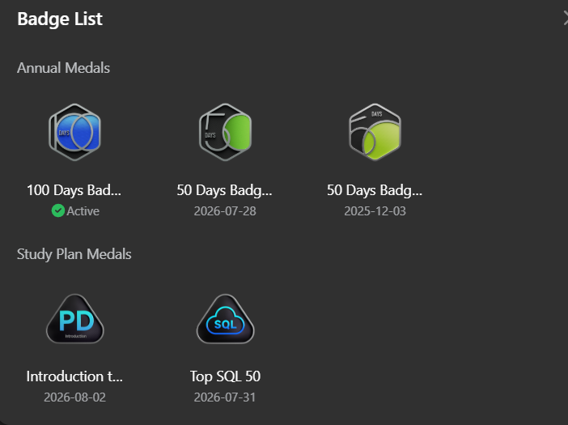

# Hi 👋, I'm Syed Misbahul Islam Golam Jwilanee

Code. Learn. Build. Repeat. | Python | AI/ML | SQL | Backend Development

🎓 B.Tech in Computer Science & Engineering (AI & ML) | 2022–2026

I'm a passionate developer from India interested in building practical software solutions using Python, Backend Development, and Artificial Intelligence. I enjoy solving programming problems, exploring new technologies, and developing real-world projects.

- 📫 Reach me at: **syedmisba2001@gmail.com**
---
## 🛠️ Languages and Tools

### Programming Languages

  

### Web Technologies

  

### Database

  

### AI / ML & Data Science

  
  
  

### Tools & IDEs

  

---

## 🚀 Featured Projects

### 1. SkinAI – AI-Powered Skin Lesion Classification

- Developed an AI-powered skin lesion classification system using **MobileNetV2**.
- Trained the model on the **HAM10000 dataset**.
- Achieved **90.22% validation accuracy**.
- Integrated the trained model into a full-stack web application.
- Used Gemini 2.5 Flash for AI-powered application features.

**Tech Stack:** Python, TensorFlow, Keras, MobileNetV2, Next.js, Gemini API.

### 2. Old Car Price Prediction

- Developed a machine learning model to predict used car prices.
- Performed data cleaning and preprocessing.
- Explored regression techniques for price prediction.
- Used Python libraries for data analysis and model development.

**Tech Stack:** Python, Pandas, NumPy, Scikit-learn, Jupyter Notebook.

---

## 💻 Problem Solving & DSA

Currently strengthening my Data Structures and Algorithms skills.

- Arrays and Strings
- Hashing and HashMap
- Two Pointers
- Sliding Window
- Prefix Sum
- Kadane's Algorithm
- Linked Lists
- Sorting and Searching
- SQL Problem Solving

---
---

## 🏆 LeetCode Achievements

  

  

---

## 📊 GitHub Statistics

  
  

  

---

## 🤝 Connect With Me

  

---

  <b>Code. Learn. Build. Repeat. 🚀</b>
   
  ⭐ Thanks for visiting my profile!

